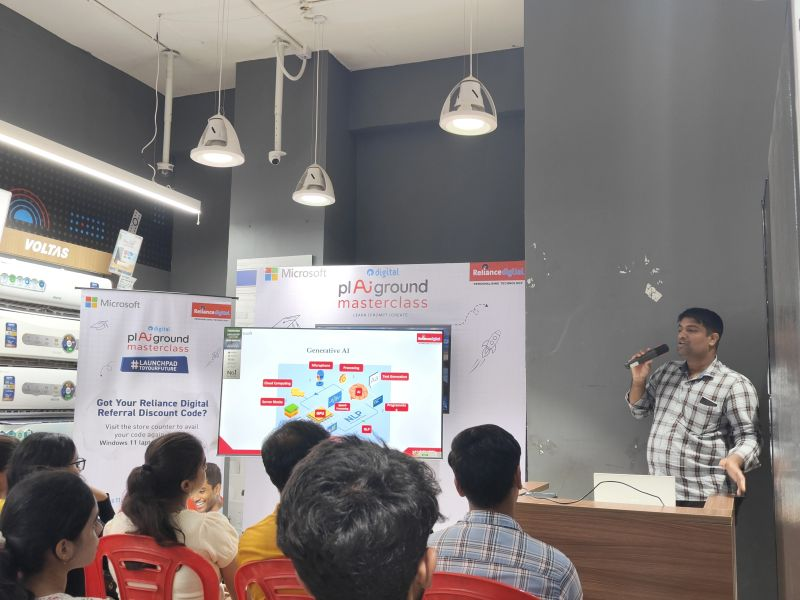
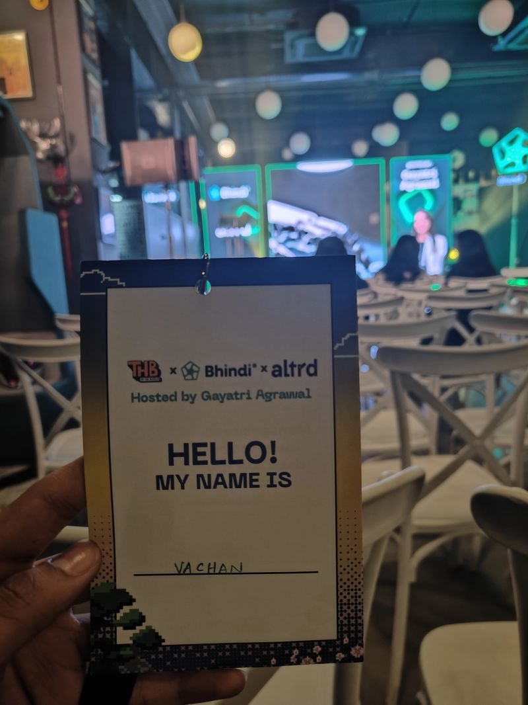
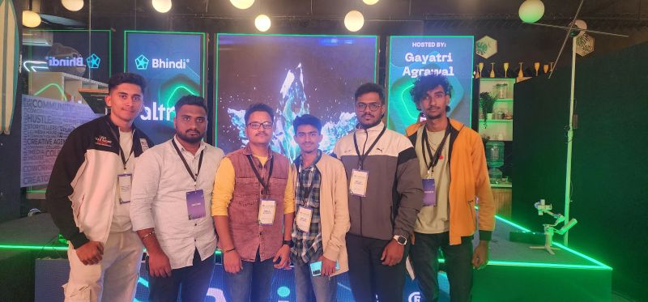
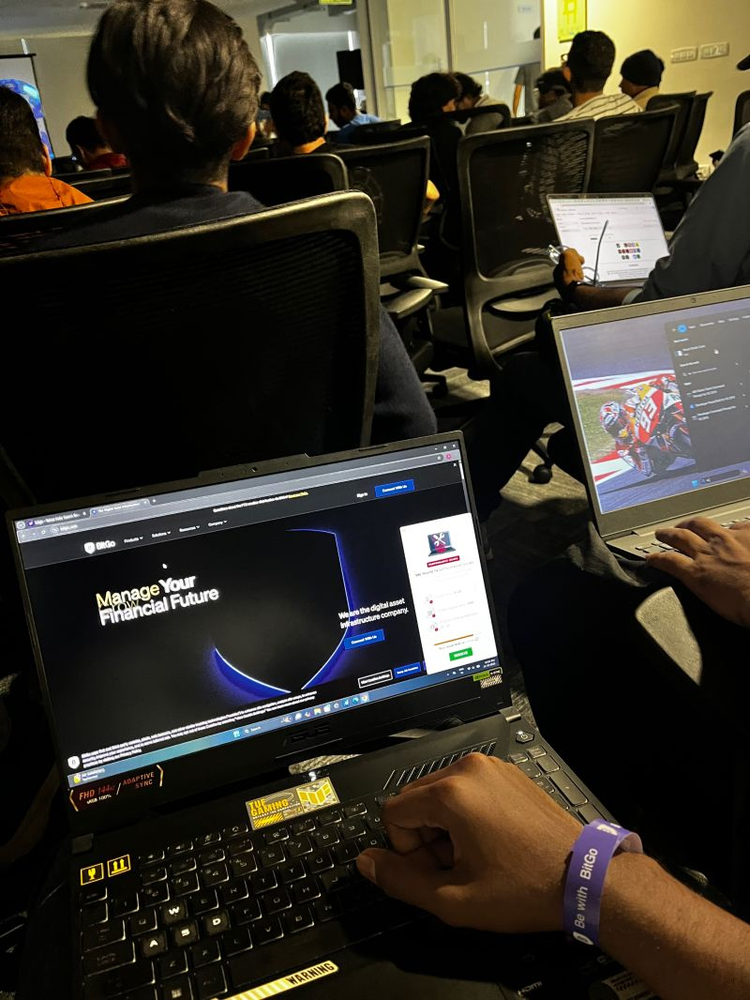
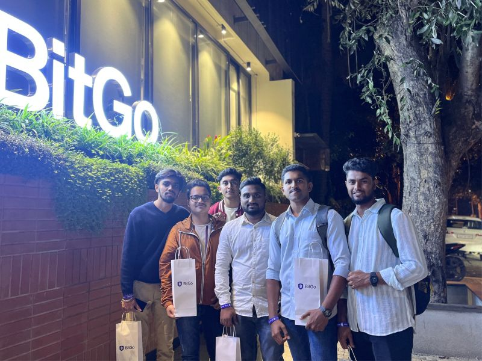
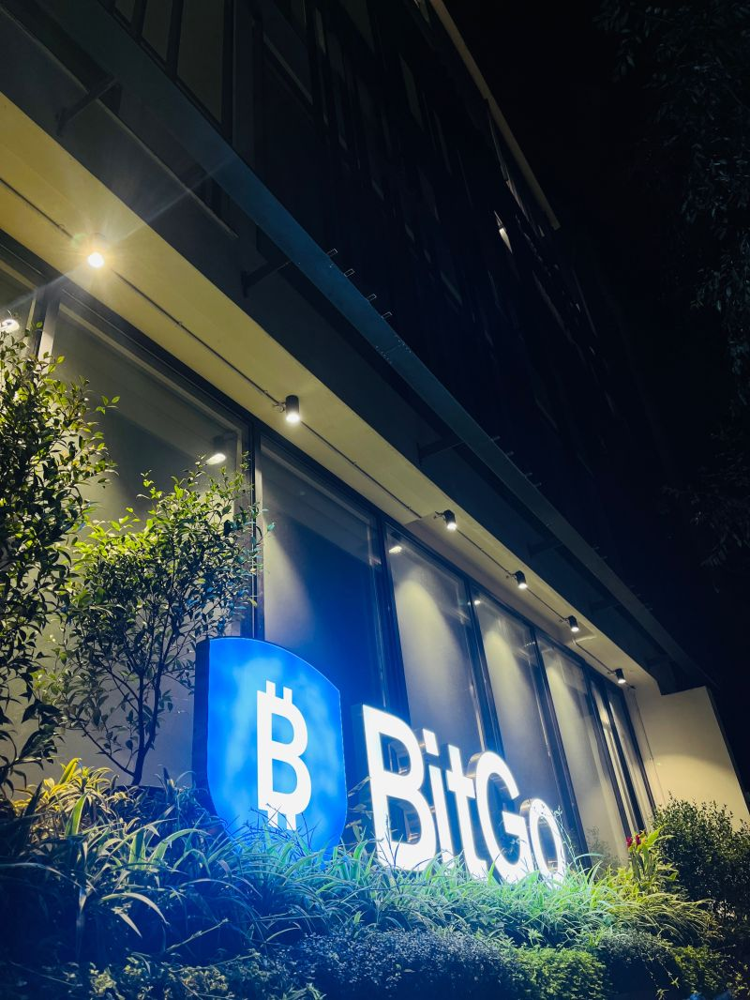
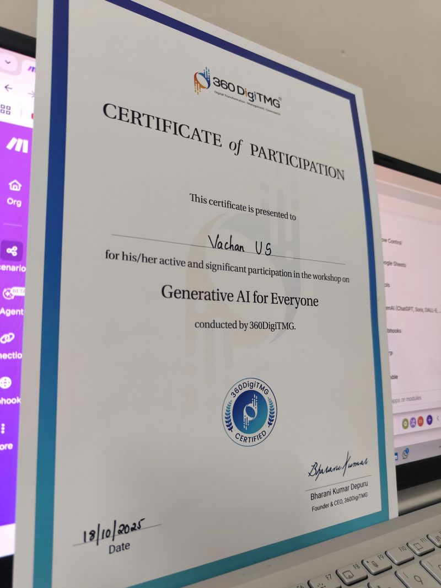
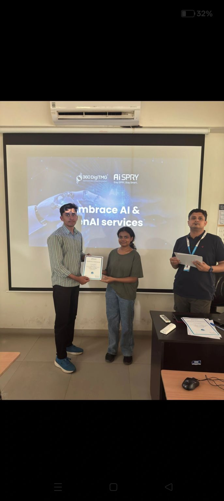
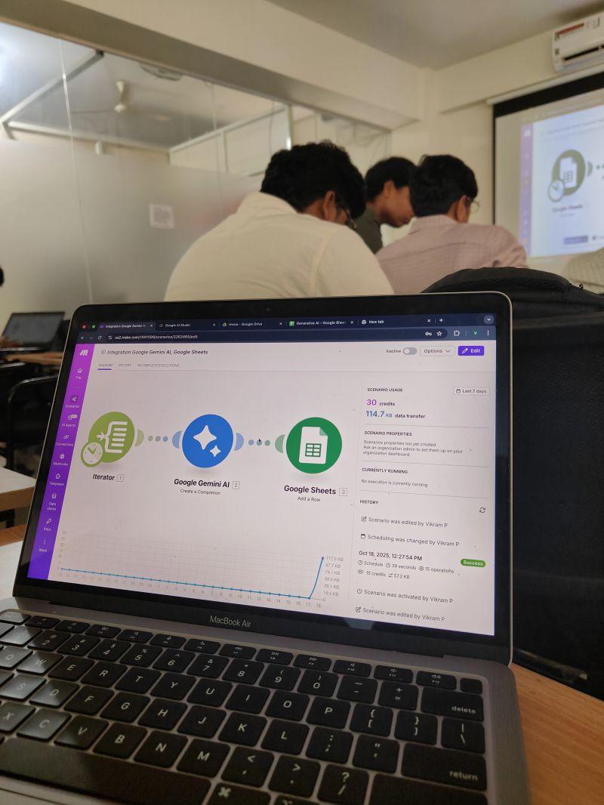
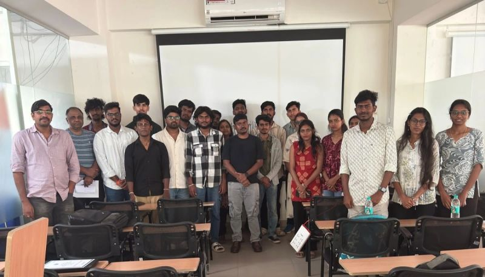

# 🎓 Workshop & Masterclass Gallery

A visual journey and curated gallery of technical workshops, industry masterclasses, hands-on hackathons, and developer conferences attended by **[Vachan U S](https://github.com/vachan18)**.

---

## 📑 Table of Contents

1. [Microsoft & Reliance Digital: AI Playground Masterclass](#1-microsoft--reliance-digital-ai-playground-masterclass)
2. [THB × Bhindi × altrd: Interactive Tech & Creator Meetup](#2-thb--bhindi--altrd-interactive-tech--creator-meetup)
3. [BitGo: Web3 & Digital Asset Infrastructure Deep Dive](#3-bitgo-web3--digital-asset-infrastructure-deep-dive)
4. [360DigiTMG / AiSPRY: Generative AI for Everyone](#4-360digitmg--aispry-generative-ai-for-everyone)

---

## 1. Microsoft & Reliance Digital: AI Playground Masterclass

> **Focus:** Generative AI Architecture, Natural Language Processing, Prompt Engineering, Cloud Infrastructure, and AI Hardware / Windows 11 Copilot PCs.

<table>
  <tr>
    <td width="50%">
      
      
<b>Event Entrance & Masterclass Launchpad</b>

    </td>
    <td width="50%">
      
      
<b>Masterclass Cohort & Tech Mentors</b>

    </td>
  </tr>
  <tr>
    <td colspan="2">
      
      
<b>Technical Deep-Dive: GenAI Architecture, Speech Processing & LLMs</b>

    </td>
  </tr>
</table>

### Key Highlights
- **Architecture Exploration:** Analyzed how modern Generative AI models integrate with cloud compute backends, speech-to-text, neural pipelines, and real-time generation frameworks.
- **Hands-on Prompt Design:** Experimented with zero-shot, few-shot, and chain-of-thought prompt engineering patterns.
- **Hardware Acceleration:** Explored on-device NPU acceleration with Copilot+ AI PC hardware and Windows 11 workflows.

---

## 2. THB × Bhindi × altrd: Interactive Tech & Creator Meetup

> **Hosted by:** Gayatri Agrawal  
> **Focus:** Creative Tech, Physical Computing, Robotics, AI Interactions & Community Building.

<table>
  <tr>
    <td width="33%">
      
      
<b>Attendee Delegate Badge</b>

    </td>
    <td width="33%">
      
      
<b>"Talk To Me" AI Robotics Installation</b>

    </td>
    <td width="34%">
      
      
<b>Stage Cohort & Organizers</b>

    </td>
  </tr>
</table>

### Key Highlights
- **Interactive AI & Hardware:** Experienced custom physical robotics incorporating responsive animated displays and voice synthesis.
- **Cross-Disciplinary Synergy:** Discussed digital media transformations, future agency workflows, and developer-designer collaborations.

---

## 3. BitGo: Web3 & Digital Asset Infrastructure Deep Dive

> **Focus:** Blockchain Security, Institutional Custody Architecture, Multi-Sig Wallets, and Digital Asset Infrastructure.

<table>
  <tr>
    <td width="50%">
      
      
<b>Hands-on Session: Exploring Digital Asset Infrastructure</b>

    </td>
    <td width="50%">
      
      
<b>Developer Cohort at BitGo Headquarters</b>

    </td>
  </tr>
  <tr>
    <td colspan="2">
      
      
<b>BitGo Office — Evening Developer Session</b>

    </td>
  </tr>
</table>

### Key Highlights
- **Enterprise-Grade Security:** Explored BitGo's security mechanisms, multisignature threshold cryptography, and API integration for institutional digital assets.
- **Developer Networking:** Connected with blockchain infrastructure engineers and fellow Web3 builders.

---

## 4. 360DigiTMG / AiSPRY: Generative AI for Everyone

> **Certification:** Active & Significant Participation in Generative AI for Everyone  
> **Certified Date:** 18/10/2025 | Issued by Bharani Kumar Depuru (Founder & CEO, 360DigiTMG)

<table>
  <tr>
    <td width="50%">
      
      
<b>Certificate of Participation: Generative AI for Everyone</b>

    </td>
    <td width="50%">
      
      
<b>Certificate Felicitation & Awarding Ceremony</b>

    </td>
  </tr>
  <tr>
    <td width="50%">
      
      
<b>Workflow Lab: Google Gemini AI + Google Sheets Integration via Make.com</b>

    </td>
    <td width="50%">
      
      
<b>Workshop Classroom Cohort</b>

    </td>
  </tr>
</table>

### Key Highlights
- **Applied Generative AI Pipeline:** Built automated multi-step AI workflows linking **Google Gemini AI** completions directly into **Google Sheets** using Make.com iteration routers.
- **Enterprise AI Use Cases:** Analyzed prompt engineering patterns, structured JSON extraction, and end-to-end data enrichment pipelines.

---

## 🛠️ Tech Stack & Topics Mastered

`Generative AI` • `Google Gemini API` • `Prompt Engineering` • `LLM Orchestration` • `Make.com Automation` • `Web3 Infrastructure` • `Blockchain Security` • `Physical Computing & Robotics` • `Windows 11 Copilot / NPU`

---

## 📬 Connect with Me

- **GitHub:** [@vachan18](https://github.com/vachan18)
- **Portfolio:** [vachan18.github.io](https://vachan18.github.io)
- **Email:** [vachanus@gmail.com](mailto:vachanus@gmail.com)
